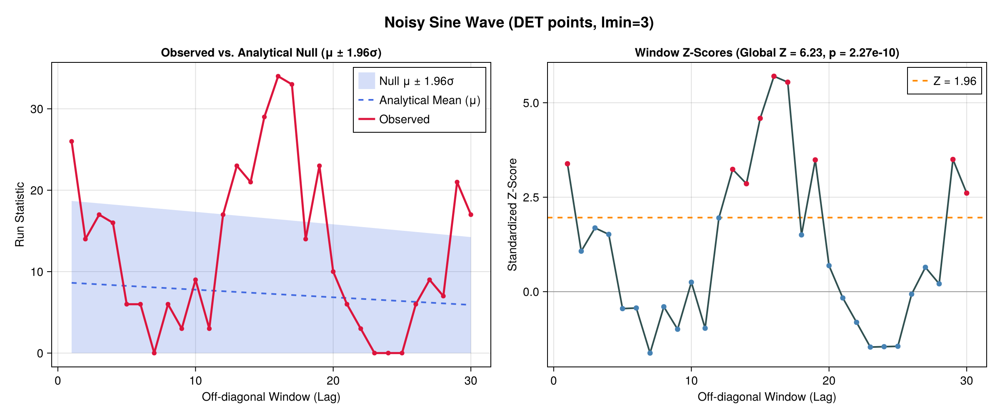
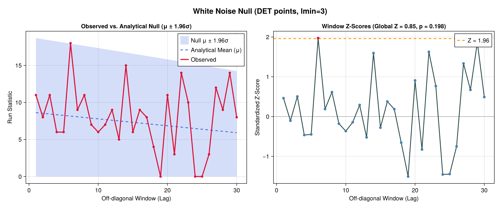

# SymbolicInference

[](https://fargolo.github.io/SymbolicInference.jl/stable/)
[](https://fargolo.github.io/SymbolicInference.jl/dev/)
[](https://github.com/fargolo/SymbolicInference.jl/actions/workflows/CI.yml?query=branch%3Amain)

Probability-based inferences based on the symbolic method.  

This software implements algorithms that leverage analytic combinatorics to make inference about different types of objects. [See AnalyticComb.jl](https://fargolo.github.io/AnalyticComb.jl/dev/)  

## Time-series  

### Chaotic, non-linear systems and recurrence analysis  

See the [white-paper](https://osf.io/preprints/osf/3ws85) and its [repo](https://github.com/fargolo/paper-vignettes/)

The recurrence of states, in the meaning that states are again arbitrarily close after some time of divergence, is a fundamental property of deterministic dynamical systems and is typical for nonlinear or chaotic systems.  

Poincaré discussed this property in 1890 and it was later proved by Constantin Carathéodory (see Poincaré recurrence theorem). Further on, several techniques address recurrences in dynamical systems for inference.  

Recurrence plots (RPs) were creature to capture such patterns and several parameters that characterize the underlying time-series can be obtained with recurrence quantification analysis (RQA).  

Since each pair of states is mapped into a binary value ('close enough',1, or 'not close enough',0), making probabilistic inference with symbolic methods is straightforward.  

The procedure in `rec_matrix_motifs()` iterates over [recurrence matrices](https://juliadynamics.github.io/DynamicalSystemsDocs.jl/recurrenceanalysis/stable/) diagonals and checks for repeated motifs. Specifically, whether the size of the longest consecutive sequence in each off-diagonal is unexpectedly large. This may hint at underlying patterns, such as autocorrelations and periodic components.  

  
  

### Analytical Hypothesis Testing for RQA Metrics via Marked BGFs

Using marked Bivariate Generating Functions from `AnalyticComb.jl` (`weighted_bin_runs_moments`), `rqa_moments_test` and `plot_rqa_moments` provide exact analytical means, variances, standardized $Z$-scores, and $p$-values for RQA diagonal statistics (**Determinism ($DET$)**, motif counts, and line-length histograms) without surrogate shuffling:

```julia
using RecurrenceAnalysis, SymbolicInference

rm = RecurrenceMatrix(noisy_sin, 0.35; fixedrate=true)
res = rqa_moments_test(rm; lmin=3, window_range=collect(1:30), metric="determinism")
fig = plot_rqa_moments(res; title_prefix="Noisy Sine Wave (DET points, lmin=3)")
```




See the [full RQA Moments Vignette](docs/src/vignette_moments.md) for details.

  

## Graphs  

## Genomics  
